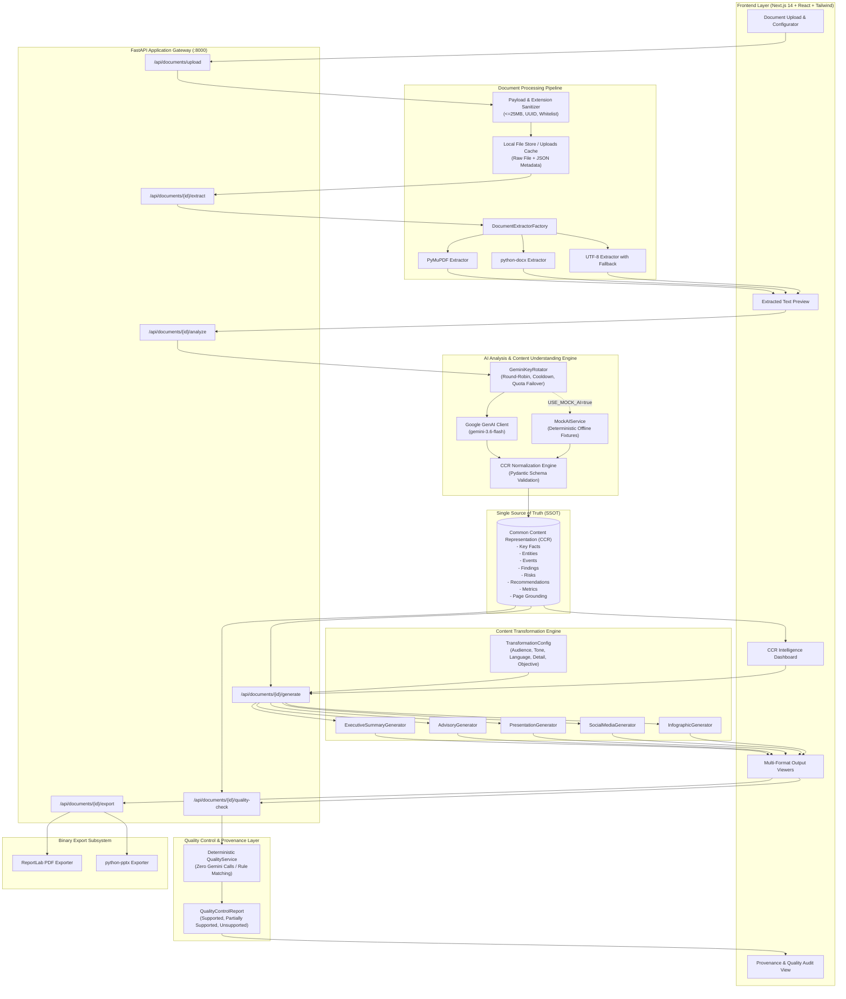

# NTRO GenAI Platform: Technical Stack & Pipeline Architecture

## 1. Executive Summary & System Philosophy

The **NTRO GenAI Content Transformation Platform** is an enterprise-grade, intelligence-oriented system developed for the **National Technical Research Organisation (NTRO)**. It transforms heterogeneous, dense technical and intelligence documents (PDF, DOCX, TXT) into high-fidelity, audience-tailored deliverables (Executive Briefings, Actionable Advisories, Slide Decks, Social Media Threads, and Infographic Specifications) with zero-compromise factual grounding.

### Core Architectural Axioms

1. **Single Source of Truth (SSOT)**: Raw document contents are ingested and normalized into a unified, structured **Common Content Representation (CCR)** schema using Google Gemini. All downstream deliverable generators operate exclusively on the validated CCR rather than raw unstructured text, preventing semantic drift and redundant LLM inferences.
2. **Deterministic Quality & Provenance Verification**: Claims in generated outputs are audited by a **Zero-LLM, rule-based verification engine** that matches claims, metrics, and entities against the CCR. This guarantees mathematically verifiable provenance and eliminates hallucinated artifacts.
3. **Resilient Key Rotation & Failover**: Gemini API requests are orchestrated through a thread-safe round-robin key rotator with automated cooldown tracking, preventing quota-induced service interruptions.
4. **Air-Gapped & Offline Readiness**: Supports full offline demonstration and testing via a deterministic mock layer (`USE_MOCK_AI=true`), enabling testing without external network egress or API keys.

---

## 2. Technology Stack Matrix

| Layer / Category | Technology | Version | Purpose & Architectural Rationale |
| :--- | :--- | :--- | :--- |
| **Frontend Framework** | **Next.js** (App Router) | `14.2.5` | Modern server/client hybrid rendering, fast routing, enterprise component scalability. |
| **UI Library** | **React** | `18.3.1` | Component-driven reactive user interface for interactive document intelligence dashboards. |
| **Type Safety** | **TypeScript** | `5.5.4` | Strict compile-time typing across all API payloads, component props, and transformation states. |
| **CSS & Design System** | **Tailwind CSS** + **PostCSS** | `3.4.7` / `8.4.40` | Utility-first responsive design, dark/light theme support, glassmorphic UI tokens. |
| **Icons & Micro-interactions** | **Lucide React** | `0.424.0` | Accessible, tree-shakeable SVG icon collection for clean government/defence UI ergonomics. |
| **Backend Framework** | **FastAPI** | `>=0.109.0` | High-performance asynchronous ASGI web framework with automatic OpenAPI/Swagger documentation. |
| **ASGI Web Server** | **Uvicorn** (standard) | `>=0.27.0` | Production-ready, lightning-fast async event loop server implementation for Python. |
| **Data Validation & Schemas** | **Pydantic v2** & **pydantic-settings** | `>=2.6.0` | Rigorous schema enforcement, type coercion, and environment variable configuration validation. |
| **Generative AI SDK** | **Google GenAI SDK** (`google-genai`) | `>=0.1.0` | Native interface to Google Gemini models (`gemini-3.6-flash` / `gemini-1.5-flash`). |
| **PDF Extraction** | **PyMuPDF** (`fitz`) | `>=1.23.0` | C-optimized, page-aware text and layout extraction with high precision for multi-column PDFs. |
| **DOCX Extraction** | **python-docx** | `>=1.1.0` | Structured document object model traversal for Microsoft Word (.docx) files. |
| **PDF Generation** | **ReportLab** | `>=4.1.0` | Programmatic, server-side PDF document publishing engine with exact typography and styling control. |
| **PowerPoint Generation** | **python-pptx** | `>=0.6.23` | Native Microsoft PowerPoint (.pptx) binary slide creation with custom themes and notes. |
| **Relational Database** | **PostgreSQL** (Dockerized) | `15-alpine` | Containerized relational database for persistent document metadata, user history, and audit logs. |
| **Testing & Test Client** | **pytest** + **FastAPI TestClient** | `>=8.0.0` | End-to-end testing suite comprising 115+ automated security, boundary, and regression tests. |
| **Containerization** | **Docker** & **Docker Compose** | `3.8+` | Containerized orchestration isolating frontend, backend, and PostgreSQL services. |

---

## 3. End-to-End Pipeline Architecture



---

## 4. Pipeline Stages: Step-by-Step Flow

### Stage 1: Document Ingestion & Validation
* **Endpoint**: `POST /api/documents/upload`
* **Handler**: [`DocumentService.save_document`](file:///d:/SIH/backend/app/services/document_service.py#L23-L65)
* **Operations**:
  1. Validates that the uploaded payload is non-empty and does not exceed `MAX_UPLOAD_SIZE_MB` (25 MB).
  2. Sanitizes input filenames against path traversal exploits (e.g. `../../`, null bytes).
  3. Verifies extension against strict whitelist: `ALLOWED_EXTENSIONS = {"pdf", "docx", "txt"}`.
  4. Generates a secure, unguessable UUIDv4 `document_id`.
  5. Atomically writes the raw file and accompanying metadata JSON to `backend/uploads/`.

### Stage 2: Page-Aware Text Extraction
* **Endpoint**: `POST /api/documents/{document_id}/extract`
* **Handler**: [`DocumentService.extract_document`](file:///d:/SIH/backend/app/services/document_service.py#L67-L95)
* **Operations**:
  1. Instantiates the appropriate extractor via `DocumentExtractorFactory`:
     - **PDF**: Uses `fitz` (PyMuPDF) to iterate over pages, preserving exact 1-indexed page boundaries.
     - **DOCX**: Traverses paragraph and table XML nodes, grouping content into logical virtual pages.
     - **TXT**: Performs UTF-8 decoding with multi-encoding fallback (`latin-1`, `cp1252`), chunking into 3,000-character logical pages.
  2. Generates document-level metadata (total pages, word count, character count).
  3. Returns page-aware text array ready for UI preview and subsequent AI analysis.

### Stage 3: AI Grounding & CCR Construction
* **Endpoint**: `POST /api/documents/{document_id}/analyze`
* **Handler**: [`GeminiAIService.analyze_document`](file:///d:/SIH/backend/app/services/ai_service.py#L49-L75)
* **Operations**:
  1. Enforces **Large Document Guard** (`MAX_DOCUMENT_CHARS = 100,000`).
  2. Packages page-grounded text into structured system and user prompts.
  3. Queries Google Gemini through `GeminiKeyRotator` using JSON schema-constrained generation.
  4. Parses and validates the LLM response into the canonical `CommonContentRepresentation` (CCR).
  5. Stores the CCR as the single authoritative ground truth for all subsequent operations.

### Stage 4: Audience-Adaptive Output Generation
* **Endpoint**: `POST /api/documents/{document_id}/generate`
* **Handler**: [`OutputService.generate_outputs`](file:///d:/SIH/backend/app/services/output_service.py#L35-L85)
* **Input Parameters** (`TransformationConfig`):
  - **Audience**: `Senior Officials` | `Technical Personnel` | `Field Personnel` | `General Audience`
  - **Tone**: `Formal` | `Technical` | `Neutral` | `Simplified`
  - **Language**: `English` | `Hindi` | `Marathi`
  - **Detail Level**: `Brief` | `Medium` | `Detailed`
  - **Objective**: `Inform` | `Brief` | `Advise` | `Explain` | `Recommend`
* **Output Deliverable Generators**:
  - **Executive Summary Generator**: High-level briefings, statistics, operational risks, and recommendations.
  - **Actionable Advisory Generator**: Situation analysis, findings, risk assessment, and prioritized directives.
  - **Presentation Slide Deck Generator**: Multi-slide structure with titles, talking points, speaker notes, and page citations.
  - **Social Media Generator**: Platform-tailored copy for LinkedIn and X (Twitter), including hashtags and thread continuity.
  - **Infographic Specification Generator**: Visual section breakdown with recommended visualization types (`timeline`, `bar_chart`, `number_highlight`, `process_flow`, `comparison`, `map`).

### Stage 5: Deterministic Quality Control & Provenance Verification
* **Endpoint**: `POST /api/documents/{document_id}/quality-check`
* **Handler**: [`QualityService.generate_report`](file:///d:/SIH/backend/app/services/quality_service.py#L29-L72)
* **Core Design**: **Zero LLM calls during quality check**.
* **Verification Algorithm**:
  1. Extracts factual assertions, numerical figures, dates, entity names, and actionable recommendations from generated output models using deterministic regex and pattern extractors.
  2. Compares each assertion against the CCR knowledge base:
     - **Supported**: Exact or semantic token match with inherited page numbers and exact quote grounding.
     - **Partially Supported**: Partial overlap with core CCR facts; requires human-in-the-loop review.
     - **Unsupported**: Facts, numbers, or entities present in output but absent from CCR (flagged as potential hallucinations).
     - **Recommendation**: Prescriptive directives tracked with priority ratings.
  3. Aggregates overall health status:
     - `passed` (0 unsupported claims)
     - `review_required` (partial matches detected)
     - `failed` (unsupported or contradictory claims found)

### Stage 6: Binary Document Export
* **Endpoint**: `POST /api/documents/{document_id}/export`
* **Handler**: [`ExportService.export_output`](file:///d:/SIH/backend/app/services/export_service.py#L22-L89)
* **Operations**:
  1. Consumes validated Pydantic models directly; does not invoke external AI models.
  2. Renders pixel-perfect, secure downloadable binary files:
     - **Executive Summaries & Advisories**: Built with **ReportLab**, featuring customized headers, NTRO typography, priority badges, and citation footers.
     - **Presentation Decks**: Built with **python-pptx**, rendering 16:9 widescreen slides, styled title banners, bullet hierarchies, and presenter notes.
  3. Streams file binary with strict MIME headers and browser download attachment disposition.

---

## 5. Core Data Contracts & Schemas

### 5.1 Common Content Representation (CCR)
```python
class CommonContentRepresentation(BaseModel):
    document_title: str
    document_topic: str
    executive_context: str
    key_facts: List[KeyFact]                  # [{ fact, source_page }]
    entities: List[Entity]                    # [{ name, type, source_page }]
    events: List[Event]                      # [{ description, date, source_page }]
    key_findings: List[KeyFinding]            # [{ finding, importance, source_page }]
    risks: List[Risk]                        # [{ risk, severity, source_page }]
    recommendations: List[Recommendation]    # [{ recommendation, priority, source_page }]
    important_statistics: List[Statistic]    # [{ metric, value, context, source_page }]
    source_references: List[SourceReference]  # [{ page_number, supporting_text }]
```

### 5.2 Transformation Configuration
```python
class TransformationConfig(BaseModel):
    audience: AudienceEnum = AudienceEnum.SENIOR_OFFICIALS
    tone: ToneEnum = ToneEnum.FORMAL
    language: LanguageEnum = LanguageEnum.ENGLISH
    detail_level: DetailLevelEnum = DetailLevelEnum.MEDIUM
    communication_objective: CommunicationObjectiveEnum = CommunicationObjectiveEnum.INFORM
```

### 5.3 Quality Control & Provenance Schema
```python
class ClaimProvenance(BaseModel):
    claim_id: str
    claim_text: str
    claim_type: str            # 'statistic', 'finding', 'risk', 'recommendation', etc.
    support_status: str        # 'supported', 'partially_supported', 'unsupported', 'recommendation'
    source_pages: List[int]
    supporting_text: List[str]
    confidence: Optional[str]  # 'high', 'medium', 'low'
    reason: str
    output_type: str

class QualityControlReport(BaseModel):
    document_id: str
    overall_status: str        # 'passed', 'review_required', 'failed'
    total_claims: int
    supported_claims: int
    partially_supported_claims: int
    unsupported_claims: int
    recommendations: int
    claims: List[ClaimProvenance]
```

---

## 6. Resilience, Security & Operational Architecture

```text
┌─────────────────────────────────────────────────────────────────────────┐
│                      Security & Resilience Architecture                 │
├───────────────────────────────┬─────────────────────────────────────────┤
│ Security Controls             │ Implementation                          │
├───────────────────────────────┼─────────────────────────────────────────┤
│ Zero Key Leakage              │ Keys managed via backend/.env only;     │
│                               │ never sent to client or logged.         │
├───────────────────────────────┼─────────────────────────────────────────┤
│ Path Traversal Prevention     │ Document IDs are UUIDs; checked with    │
│                               │ Path.is_relative_to(UPLOAD_DIR).        │
├───────────────────────────────┼─────────────────────────────────────────┤
│ Denial-of-Service Defense     │ 25MB max file size; 100,000 character   │
│                               │ single-pass processing limit.           │
├───────────────────────────────┼─────────────────────────────────────────┤
│ Gemini API Key Rotator        │ Thread-safe round-robin rotator with    │
│                               │ per-key cooldown on HTTP 429/quota limits│
├───────────────────────────────┼─────────────────────────────────────────┤
│ Offline Demonstration Mode    │ USE_MOCK_AI=true provides 100% deterministic│
│                               │ mock generation without internet access.│
└───────────────────────────────┴─────────────────────────────────────────┘
```

### Gemini API Key Rotator Architecture
The [`GeminiKeyRotator`](file:///d:/SIH/backend/app/services/gemini_rotator.py#L12-L100) manages API key pools configured via comma-separated `GEMINI_API_KEYS` or single `GEMINI_API_KEY`:
1. **Thread-Safe Key Selection**: Uses mutex locks to hand out keys across concurrent ASGI worker threads.
2. **Dynamic Cooldown Tracking**: When a key encounters a 429 Quota Exceeded or ResourceExhausted error, it is marked as exhausted with a 60-second cooldown window.
3. **Transparent Failover**: Automatically cycles to the next healthy key in the pool and retries the operation without failing the user's request.

---

## 7. Deployment & Infrastructure

### Container Layout (`docker-compose.yml`)

```text
                             ┌───────────────────┐
                             │    Browser / UI   │
                             └─────────┬─────────┘
                                       │ Port 3000
                                       ▼
                       ┌───────────────────────────────┐
                       │  ntro_genai_frontend          │
                       │  (Next.js 14 Standalone)      │
                       └───────────────┬───────────────┘
                                       │ HTTP Internal / API Proxy
                                       │ Port 8000
                                       ▼
                       ┌───────────────────────────────┐
                       │  ntro_genai_backend           │
                       │  (FastAPI + Python 3.11)      │
                       └───────────────┬───────────────┘
                                       │ Port 5432
                                       ▼
                       ┌───────────────────────────────┐
                       │  ntro_genai_db                │
                       │  (PostgreSQL 15 Alpine)       │
                       └───────────────────────────────┘
```

### Ports & Network Topology
- **Frontend Container**: `3000:3000` (Next.js App Router)
- **Backend Container**: `8000:8000` (FastAPI REST API)
- **Database Container**: `5432:5432` (PostgreSQL with persistent volume `postgres_data`)

---

## 8. Summary of Architectural Advantages

1. **Hallucination-Proof**: Single Source of Truth (CCR) + Zero-LLM Deterministic Provenance Verification ensure all output claims are grounded in source documents.
2. **Enterprise Reliability**: Multi-key Gemini rotation and offline mock capabilities guarantee high availability.
3. **Format Versatility**: Multi-format output generation across executive briefs, operational advisories, presentation slides, social copy, and infographics.
4. **Air-Gapped & Secure**: Strict input validation, zero client-side key exposure, and native server-side PDF/PPTX rendering.
